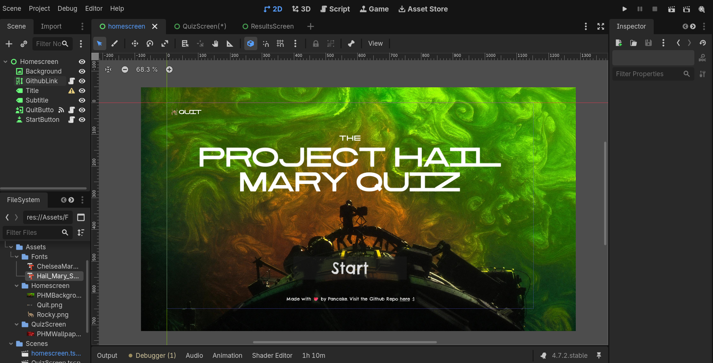
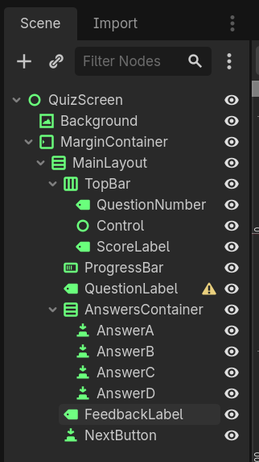
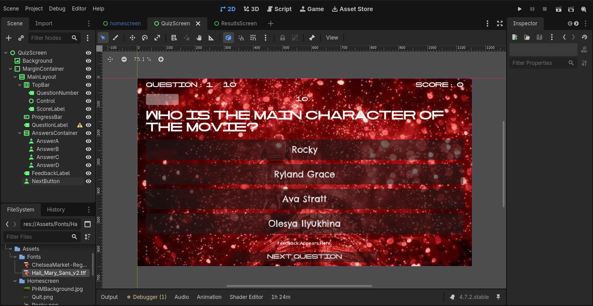
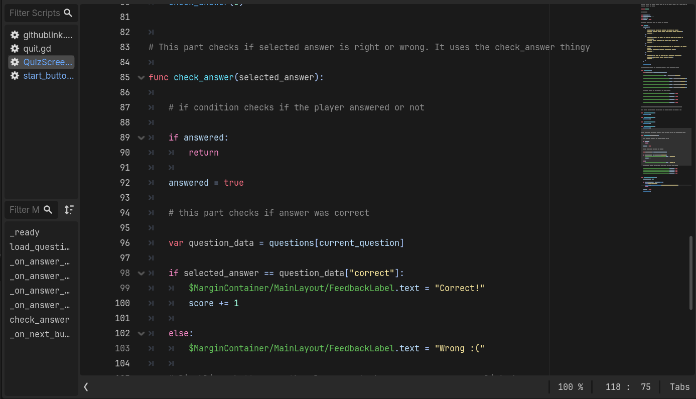

## Day 01 - 25 / 11 / 2026
- Started the project!
- Learnt how to add hyperlinks to text in Godot using BBCode
- Got some assets from google (background and character pics) and made the homescreen.
- Found a guy on Reddit who made the PHM font, was super helpful lol. Check it out if you want, it's in the README

## Day 02 - 26 / 11 / 2026
- I created basic node trees for the quiz and result scenes. Here's a pic of the node tree of the quiz page :D

- Started making the scenes aesthetically pleasing, cuz they looked BAD. Added a few other fonts as well.

- I coded a LOT today as well - I didnt copy from an AI assistant buut I sadly had to ask it stuff cuz I've never coded with GDScript before. However, I am happy to say that I asked it once, and replicated it (with a lot of errors) without much use of AI :> Here's a pic btw!

